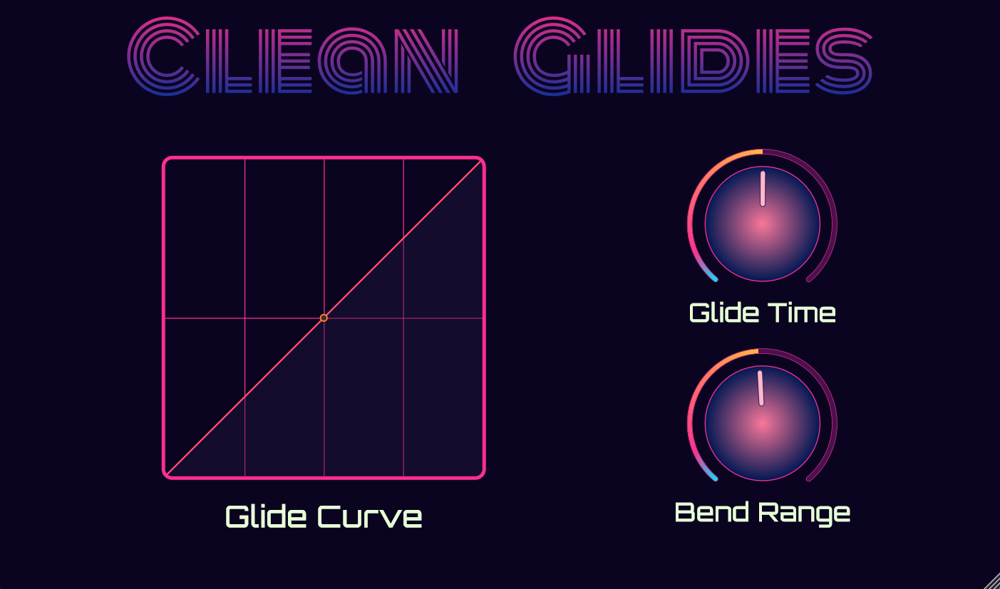

   

---

<h3 align="center">MPE MIDI plugin creating smooth glides between notes using pitch bend</h3>

---

## About Clean Glides

Clean Glides is an MPE MIDI plugin that can be routed to an MPE-compatible instrument to intercept MIDI notes and transform them into monophonic gliding notes per channel.

Clean Glides was hugely inspired by [PolyPortamento](https://github.com/suzumushi0/PolyPortamento_binary) made by [suzumushi0](https://github.com/suzumushi0). 
If you enjoy it, I would strongly recommend having a look at his work and his other plugins (they are awesome).

## How It Works

While the VST3 version of Clean Glides is being loaded in your DAW as an instrument, it behaves more like an effect, as on its own, Clean Glides does not produce any sound.

It works by sitting between your MIDI notes and your instrument. 
This allows it to read your MIDI notes on each channel before they reach your instrument and modify the MIDI events to transform incoming notes into per channel pitch bend.
This creates a smooth and continuous glide effect (portamento) between notes.

## How To Install

### Windows 10 and above
- Head over to the [release section](https://github.com/AbriCroco/Clean-Glides/releases) and download the latest windows-specific .zip archive.
- Unzip the archive, double-click on `Install.bat` and click on **Run** when prompted.
- Restart your DAW and rescan your plugin list as per usual when installing a new plugin.
- That's it! You're now all set to use Clean Glides.

For more detailed installation guidance, open the `README.txt` inside the .zip archive.

### macOS 11.0 and above
- Head over to the [release section](https://github.com/AbriCroco/Clean-Glides/releases) and download the latest macOS-specific .zip archive.
- Double-click on the .zip archive to unzip it.
- Double-click on the .dmg file for your desired version of the plugin (AU for Logic, VST3 for other DAWs).
- Drag and drop the file (`Clean Glides.component` for AU / `Clean Glides.vst3` for VST3) into the folder indicated by the shortcut.

**IMPORTANT NOTE:** As this plugin is not notarized by Apple, you will most likely need to manually authorize it on your Mac to be able to use it.
For a smoother experience, I would recommend doing so before attempting to restart your DAW and use the plugin, but you can freely do so at any point.

Please read the included `README.txt` section `2. macOS SECURITY NOTICE - QUARANTINE` to fully understand why this step is necessary, what it means and how to achieve it.

### Linux glibc 2.35 and above
- Head over to the [release section](https://github.com/AbriCroco/Clean-Glides/releases) and download the latest linux-specific .zip archive.
- Unzip the archive, and open a terminal in the extracted folder.
- Run `bash install.sh` to install the plugin for your user only, or `bash install.sh --system` to install it for all users.
- Restart your DAW and rescan your plugin list as per usual when installing a new plugin.
- That's it! You're now all set to use Clean Glides.

For more detailed installation guidance, open the `README.txt` inside the .zip archive.

## How To Use

Before using Clean Glides, you need to route it between your MIDI notes and your instrument. 
This allows Clean Glides to intercept incoming MIDI messages and forward the modified notes to your instrument.
The way to achieve this can vary significantly from DAW to DAW.
For this reason, the guidance below will only go over general, non-DAW specific steps. 
For more specific steps with screenshots and videos for your DAW, please refer to the [Wiki](https://github.com/AbriCroco/Clean-Glides/wiki).

### Initial routing setup

In the below steps we will cover how to properly route Clean Glides and your instrument:
- Load an instance of Clean Glides and an MPE-compatible instrument on your instrument track.
- Enable MPE in your instrument's settings if it is not enabled by default.
- Make sure the pitch bend range matches in **BOTH** your instrument and Clean Glides.
- If your DAW allows you to configure the input ports, set your instrument's input channels to **'Any'** or **'All'**, and select Clean Glides' MIDI output as its input port.
- If your DAW allows you to configure MIDI output ports, set Clean Glides' output channels to **'Any'** or **'All'**, and select the same MIDI port used as your instrument's input.
- Some DAWs require monitoring to be enabled on your instrument track for the instrument to produce sound, even when the track is not selected. Enable it if necessary.
- Make sure your MIDI notes are placed on the track containing Clean Glides, not directly on your instrument track.

At this stage, you should be able to hear your instrument when playing notes from the piano roll or a MIDI keyboard.
If everything works, proceed to the next step. Otherwise, refer to the DAW-specific setup guides in the [Wiki](https://github.com/AbriCroco/Clean-Glides/wiki) for further troubleshooting.

### Make your notes glide

By default, many DAWs assign MIDI notes and MIDI keyboard to the first channel (channel 1). 
According to MPE standards, this channel is considered the Master Channel in a lower zone configuration, which is what this plugin currently uses.

This means that if a pitch bend message is received, it will be applied to all channels, which defeats the purpose of this plugin.
For that reason, Clean Glides leaves MIDI messages on channel 1 untouched.

**In other words, notes assigned to channel 1 will not glide.**
To enable gliding, you must assign your notes to a different channel (2-16).

Keep the following rules in mind when assigning your notes:
- **Channel assignment:** Only notes assigned to channels 2-16 will glide. Channel 1 is passed through untouched.
- **Same channel:** To glide from one note to another, both notes must be assigned to the same channel.
- **Note overlap:** Notes must slightly overlap for a glide to occur. If they do not overlap, the next note will play without gliding.
- **Monophony:** Each channel from 2-16 is monophonic and can only play one note at a time. Channel 1 remains polyphonic, provided your instrument supports it.
- **Chords:** To play chords with gliding, assign each note to its own channel. In the next chord, reuse the same channels for the notes you want to glide from.

For example:
- First chord: C4 on channel 2 and E4 on channel 3.
- Second chord: D4 on channel 2 and F4 on channel 3.

C4 will glide to D4, while E4 will glide to F4.

### Understanding anchor notes and bend range

When a channel plays its first note, or a note that does not overlap with the previous one, that note becomes its new anchor note.
The attack envelope is triggered on anchor notes, while subsequent gliding notes have their attack suppressed to ensure a smooth transition.

Your anchor note also determines the pitch range available for gliding. You can only glide within the pitch bend range configured in **both** Clean Glides and your instrument.
For example, assuming a pitch bend range of 48 semitones in both Clean Glides and your instrument:
- Your first note is C3. Since there is no previous note to glide from, C3 becomes the anchor note.
- You can now glide up to 48 semitones above or below C3.
- Your next note is D7, which is 50 semitones above C3. Since this exceeds the available bend range, it cannot glide from C3.
- D7 will therefore play without gliding and become the new anchor note.
- You can now glide up to 48 semitones above or below D7.

### Illustrated example

https://github.com/user-attachments/assets/e3878215-242f-4354-a208-1b7c11af0733

Above is an illustrated example of how your MIDI notes should be assigned to hear the glides.
Each colour represents a different MIDI channel:
- Green notes (top) are assigned to channel 2.
- Red notes (middle) are assigned to channel 3.
- Pink notes (bottom) are assigned to channel 4.

#### First chord

Since there are no previous notes to glide from, each note becomes the anchor note for its respective channel, triggering its attack envelope:
- G3 is the anchor note for channel 2. Subsequent notes can glide up to 48 semitones above or below G3.
- D#3 is the anchor note for channel 3. Subsequent notes can glide up to 48 semitones above or below D#3.
- C3 is the anchor note for channel 4. Subsequent notes can glide up to 48 semitones above or below C3.

#### Second chord

The notes overlap with the previous chord, so they glide from their respective anchor notes:
- Channel 2 glides from G3 to F3.
- Channel 3 glides from D#3 to D3.
- Channel 4 glides from C3 to B2.

#### Third chord

The notes do not overlap with the previous chord, so no gliding occurs. Each note triggers its attack envelope and becomes the new anchor note for its channel:
- A#3 becomes the new anchor note for channel 2.
- G3 becomes the new anchor note for channel 3.
- D#3 becomes the new anchor note for channel 4.

#### Last chord

Since the notes overlap with the previous chord, they glide from their respective anchor notes, just as they did in the second chord.

### Understanding the UI

   

Above is a screenshot of the plugin's UI.
At the moment there are three controls available:
- The Glide Curve: You can grab the middle point to change the curvature of the modulation for your glides.
- The Glide Time knob: You can set the time it will take for your notes to glide from one to the other (from 0 ms to 10 s).
- The Bend Range knob: You can change the bend range so it matches your instrument. Do not change this without updating your instrument first or notes will glide out of tune.

When hovering over the knob, the current value will be displayed in the knob.
You can also use a couple shortcuts:
- Hold Ctrl (or Command) to change the knobs with more precision.
- Double-click on the knob or the curve to reset it to the default value.
- You can also use your mouse wheel to update the value of the knobs.

To resize the plugin, place your mouse over the three bars in the bottom right corner, click and drag the plugin to your desired size.

## AI Usage Disclosure

This project was **NOT** vibe coded. My intention when developing this project was to keep the use of AI to a minimum and only develop it using my own knowledge and efforts as well as the JUCE documentation, forums and YouTube tutorials.
For this reason I have added a [References & Resources](https://github.com/AbriCroco/Clean-Glides/edit/main/README.md#references-&-resources) section below to help others understand the code and create their own awesome plugin.

AI's role in the development of this plugin was strictly consultative. No code it wrote was used as is.
Every snippet of code written by AI was consistently read, understood, challenged and manually modified as needed before it was used.

With that in mind, AI help for the development of this plugin was only used for some complex geometric calculations, verify and fix bugs, understand Logic's limitations and implement a working Logic specific version of the plugin.
AI also helped with reworking the CMake file, licensing and complying with the AGPL-3.0 specifications and building the workflows and scripts to distribute and package the plugin on all platforms.

## License

Clean Glides is licensed under the GNU Affero General Public License v3.0 (AGPL-3.0). 
You may use, modify, and redistribute this software under the terms and conditions of the AGPLv3.
A complete copy of the license is provided in the [LICENSE](LICENSE) file. 

For more information, see: https://www.gnu.org/licenses/agpl-3.0.html

## Third-Party Software and Assets

This project uses third-party software and assets, including the [JUCE framework](https://github.com/juce-framework/JUCE) and the [CPM.cmake dependency manager](https://github.com/cpm-cmake/CPM.cmake).
Their respective licenses, copyright notices, and source information are documented in [THIRD_PARTY_LICENSES.md](THIRD_PARTY_LICENSES.md).
Please refer to that file for details about third-party components and their applicable licensing terms.

Third-party software and assets remain subject to their respective licenses.

## References & Resources

Below is a non-exhaustive list of the resources I used to create my plugin.
If you are interested in musical plugin development, I would strongly advise you to take a look at the resources below to build a stronger foundation before starting to develop your musical plugin.

### YouTube tutorial
- [Build this Awesome Audio Sampler Plugin!](https://www.youtube.com/watch?v=XkRVCiaRFEA&list=PLLgJJsrdwhPx5lOzexAhBB5ytiz7S8lYg&index=5) - To better understand how to code with JUCE.
- [Learn Modern C++ by Building an Audio Plugin (w/ JUCE Framework) - Full Course](https://www.youtube.com/watch?v=i_Iq4_Kd7Rc) - I primarily used this for creating the Glide curve UI and knobs.
- [JUCE: Custom Parameter Components](https://www.youtube.com/watch?v=SLpeh-q3oIE) - For understanding mouse events and making the controller point positioned on the curve adjustable.

### Websites
- [Understanding MPE zones](https://juce.com/tutorials/tutorial_mpe_zones/) - To help with becoming more familiar with how MPE works with JUCE.
- [JUCE 2D Graphics: Paths and Basic Geometry](https://ladan.io/posts/juce-graphics-paths/) - Great starting point for understanding how to design a UI in JUCE.

## Special Thanks

Just a quick thanks to [suzumushi0](https://github.com/suzumushi0) for the help getting started and for agreeing to let me redesign my own version of [PolyPortamento](https://github.com/suzumushi0/PolyPortamento_binary).

Also, big thanks to [pl4sis](https://crisisreunion.world/pl4sis) for helping me test Clean Glides for macOS and Logic as well as sharing some screenshots and videos to make the Logic Wiki guide feel complete. He makes great music, go check it out!
